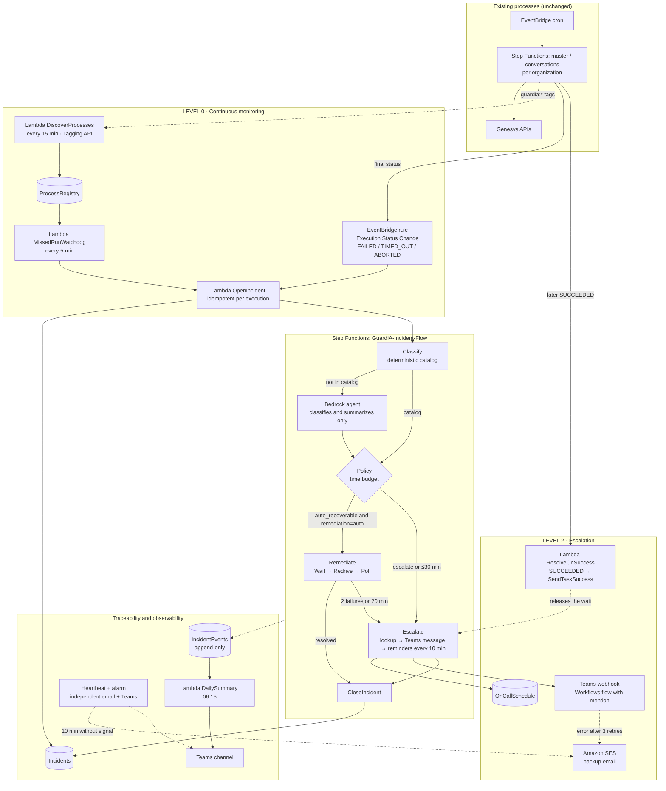
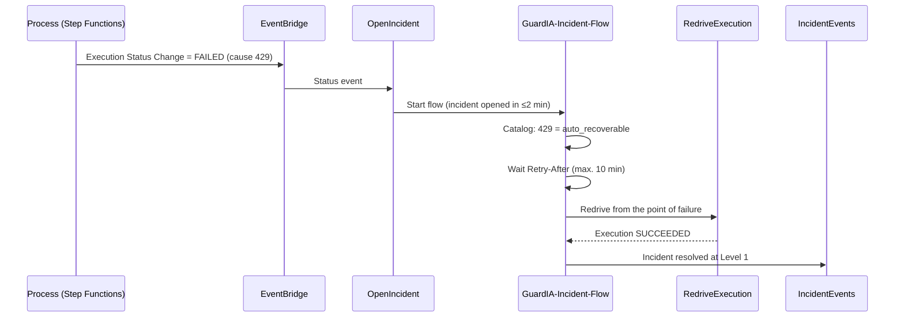
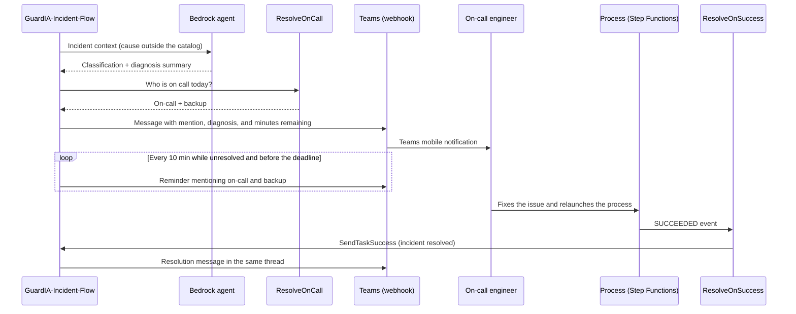

# Design Document — GuardIA

## 1. Overview

GuardIA monitors the Genesys extraction processes without modifying them. It listens to the final status of each execution (Level 0), recovers known failures with redrive (Level 1), and escalates in Microsoft Teams, with a mention of the on-call engineer and a complete diagnosis, when human judgment is needed (Level 2). It covers requirements 1 to 13 of `requirements.md`.

**Core design principle: the AI agent recommends, a deterministic policy decides.** The Amazon Bedrock agent only classifies and writes the diagnosis for errors that are not in the catalog. What action is executed, how many times, and within what time limits is decided by Step Functions, applying fixed rules. This way, a model error never turns into an action on the infrastructure.

**Stack:** Python 3.12 on AWS Lambda, AWS CDK in Python as infrastructure as code, and managed AWS services in the same region as the existing processes.

## 2. Architecture



### Sequence: 429 failure recovered at Level 1



### Sequence: unknown error escalated to Teams



## 3. Components and Interfaces

| Component | Responsibility | Input → Output | Req. |
|---|---|---|---|
| `DiscoverProcesses` (Lambda) | Lists resources with `guardia:monitor=true`, validates the other 3 tags, and updates `ProcessRegistry` | 15-minute schedule → registry rows and warnings | 1 |
| `OpenIncident` (Lambda) | Creates the incident idempotently (conditional write by execution ARN), enriches it with `DescribeExecution`, and starts the flow | Status event or `MissedRunWatchdog` event → incident + start of `GuardIA-Incident-Flow` | 2 |
| `MissedRunWatchdog` (Lambda) | Computes expected executions from the cron expression and time zone; detects `MISSED_RUN` and `STUCK_RUN` | 5-minute schedule → incident events | 3 |
| `ClassifyIncident` (Lambda) | Applies the catalog by (process type, cause) | Incident → `auto_recoverable`, `requires_escalation`, or `unknown` | 4 |
| Bedrock agent | Classifies and summarizes causes outside the catalog; no actions on the infrastructure | Incident context → `AgentDecision` (validated JSON) | 4, 12 |
| `RemediationPolicy` (library) | Pure function: given the incident, attempts, elapsed time, and remaining time, returns `REMEDIATE`, `REMEDIATE_AND_ESCALATE`, or `ESCALATE` | Incident state → decision | 5, 6 |
| `RedriveOrRestart` (Lambda) | Redrive if the execution is Standard; otherwise a new execution with the original input | Execution ARN → ARN of the new execution | 5, 12 |
| `PollExecution` (Lambda) | Queries the status of the recovered execution | ARN → status | 5 |
| `ResolveOnCall` (Lambda) | Reads `OnCallSchedule` by date (Colombia time) | Date → on-call and backup (with their Teams identifier) | 7 |
| `SendEscalation` (Lambda) | Posts an adaptive card with mentions to Teams through the webhook; retries 3 times and, if it keeps failing, sends the same content by email with SES | Incident, recipients, and diagnosis → message identifier | 7 |
| `SendReminder` (Lambda) | Posts the reminder mentioning on-call and backup, or the resolution message, in the incident thread | Incident and message type → post | 8 |
| `ResolveOnSuccess` (Lambda) | Triggered by `SUCCEEDED` events of monitored processes; if there is an escalated incident for the same process and organization, calls `SendTaskSuccess` with the stored token. After the deadline, the flow keeps waiting for this signal for up to 6 hours, without reminders, to record the resolution | Status event → `RESOLVED` incident | 8 |
| `GroupIncidents` (Lambda) | Groups 3 or more incidents with the same cause within 5 minutes | Incident → individual or grouped notification | 9 |
| `DailySummary` (Lambda) | Queries `IncidentEvents`, aggregates, and posts to Teams (email as backup) | 06:15 schedule → summary | 11 |
| `Heartbeat` and alarm | Emits a metric every minute; if it is missing for 10 minutes, a CloudWatch alarm publishes to SNS, which sends an email to the team list and triggers a Lambda that posts to Teams | Metric → email and Teams message | 13 |

### Incident event contract

```json
{
  "incident_id": "uuid",
  "execution_arn": "arn:aws:states:...:execution:...",
  "organization": "string",
  "process_type": "master | conversations",
  "kind": "FAILED | TIMED_OUT | ABORTED | MISSED_RUN | STUCK_RUN",
  "error": "string",
  "cause": "string",
  "deadline_iso": "2026-10-14T06:00:00-05:00",
  "remediation": "auto | escalate-only"
}
```

### Agent output contract (anything that does not comply is rejected)

```json
{
  "classification": "auto_recoverable | requires_escalation",
  "recommended_action": "redrive | wait_and_redrive | escalate",
  "wait_seconds": 0,
  "diagnosis_summary": "max. 400 characters",
  "confidence": 0.0
}
```

## 4. Data Models

**`ProcessRegistry`** — PK `resource_arn`

| Field | Type | Rule |
|---|---|---|
| `process_type` | String | `master` or `conversations` |
| `organization` | String | Required |
| `remediation` | String | `auto` or `escalate-only` (any other value is treated as `escalate-only`) |
| `schedule_cron`, `timezone` | String | Used to compute expected executions |
| `deadline_local` | String | Default `06:00` |
| `median_duration_s` | Number | Median of the last 14 executions |
| `last_seen_iso` | String | Timestamp of the last discovery |

**`Incidents`** — PK `incident_id`, unique index on `execution_arn`

| Field | Type | Rule |
|---|---|---|
| `status` | String | `OPEN → REMEDIATING → ESCALATED → RESOLVED`; alert state: `SLA_BREACHED` (if it is resolved later, `resolved_at` is filled in without changing the status) |
| `classification`, `level` | String, Number | `level` is 1 or 2 |
| `attempts` | Number | From 0 to 2 |
| `opened_at`, `resolved_at` | ISO string | Timestamps |
| `resolved_by` | String | `guardia` (Level 1) or `later_execution` (relaunch by a person) |
| `task_token` | String | Step Functions token that `ResolveOnSuccess` uses to close the incident; encrypted |
| `teams_thread_id` | String | Thread of the original message, for reminders and resolution |

**`IncidentEvents`** — PK `incident_id`, SK `timestamp#seq`. It is append-only: the IAM policy grants only `PutItem` with a not-exists condition. It has a 13-month TTL and point-in-time recovery.

**`ErrorCatalog`** — PK `process_type`, SK `error_pattern`

| Field | Type | Rule |
|---|---|---|
| `classification` | String | `auto_recoverable` or `requires_escalation` |
| `action` | String | `wait_and_redrive`, `redrive`, or `escalate` |
| `max_wait_s` | Number | 600 for 429 |

Initial content: 429 → `wait_and_redrive`; 403 → `escalate`; 404 with a failed execution → `escalate`; `TIMED_OUT` → `redrive`.

**`OnCallSchedule`** — PK `week_start` (Monday), with `primary` and `backup`. Each has `display_name`, `email`, and a Teams user identifier (`teams_user_id`), which is used for the mention.

**Secrets (Secrets Manager, encrypted with KMS):** webhook address of the alerts channel and webhook address of the summary channel.

## 5. Error Handling

| Scenario | System response |
|---|---|
| The agent does not respond in 30 s, returns invalid JSON, or returns a disallowed action | The incident is classified as `requires_escalation` and the event is recorded (4.6) |
| The Teams webhook returns an error | 3 retries with backoff, then email to on-call, backup, and the team list (7.3) |
| No on-call engineer for the date | The backup is notified and the warning is recorded (7.4) |
| Redrive rejected because the execution is not eligible | A new execution with the original input is launched (5.1) |
| Duplicate status event or event delivered twice | The conditional write by `execution_arn` prevents duplicates (2.4) |
| A GuardIA Lambda fails | Retries with exponential backoff, SQS DLQ, and CloudWatch alarm |
| The whole GuardIA flow fails | The heartbeat alarm sends an email to the team list through an independent path and posts to Teams (13.2) |
| Escalated incident left unresolved | Reminder every 10 min mentioning on-call and backup; at the deadline it is marked `SLA_BREACHED` and the alert is posted (6.2, 8.1, 8.2, 8.4) |
| A `SUCCEEDED` event arrives for a process with no open incident | `ResolveOnSuccess` ignores it (2.2) |
| Posting the morning summary to Teams fails | 3 retries, then email with SES (11.4) |

## 6. Testing Strategy

- **Unit (pytest, moto):** `RemediationPolicy` with a case table (attempts, elapsed time, remaining time, remediation type); catalog and validation of the agent output schema; computation of expected executions with cron and time zone; idempotency of `OpenIncident`; incident grouping.
- **Agent:** fixtures of real and adversarial errors (ambiguous causes, text that tries to force an action). Criterion: the output always meets the contract or the flow escalates.
- **Integration (test account):** tagged synthetic state machines that fail with 429, 403, and timeout. Scenarios: 429 → redrive → resolved; 403 → Teams message → reminders → successful relaunch → `RESOLVED`; unresolved until the deadline → `SLA_BREACHED`; webhook down → email; 30 minutes or less remaining → parallel escalation.
- **Security:** IAM policy tests that verify redrive is impossible on resources without `guardia:remediation=auto` and that `IncidentEvents` does not allow updates or deletes.
- **Quality criterion:** every acceptance criterion in `requirements.md` has at least one test that references it.

## 7. Design Decisions

| # | Decision | Alternatives considered | Rationale |
|---|---|---|---|
| D1 | Detection through Step Functions status events plus a watchdog every 5 minutes | Periodic polling only; CloudWatch alarms on logs | Events give detection in seconds with no polling cost; the watchdog covers what generates no event (executions that do not start or do not finish) |
| D2 | GuardIA defines 4 tags of its own with the `guardia:` prefix (`monitor`, `process-type`, `organization`, `remediation`) | Depending on each team's existing tags | An explicit, validatable contract of its own. Existing tags are left untouched, and `remediation` forces the owner to opt in to automatic remediation |
| D3 | The agent recommends and a deterministic policy decides | Letting the agent execute actions through action groups | Bounds the risk: the model cannot change the infrastructure or exceed the attempt and time limits |
| D4 | Amazon Nova Pro model in Bedrock, configurable | Models from other providers in Bedrock | Native AWS service, in the team's region and with no additional providers. The task is narrow (classify and summarize) |
| D5 | Escalation through Microsoft Teams with a Workflows (Power Automate) flow that receives a webhook and posts an adaptive card with mentions | WhatsApp with AWS End User Messaging Social; Microsoft Graph to call through Teams | Teams is already the team's tool and the webhook requires no Graph permissions, administrator consent, Meta account, or approved templates. The mention triggers the on-call engineer's mobile notification |
| D6 | Email with Amazon SES as a backup when the webhook fails | SMS or WhatsApp as a second channel | Avoids contracting numbers and additional registrations; email reaches the same group of people through a path independent of Teams |
| D7 | No delivery or read confirmation: reminders every 10 minutes until resolved | Confirming by reply or with buttons | Teams does not expose delivery or read status through a webhook. Reminders mentioning on-call and backup cover the same risk with fewer parts |
| D8 | Budget: detection ≤ 2 min, remediation ≤ 20 min, 2 attempts, maximum wait of 10 min, reminders every 10 min, parallel escalation with 30 min or less | Fixed thresholds independent of the SLA | They come from the real margin of about 60 minutes between 4:00 a.m. and 6:00 a.m., and leave at least 25 minutes for a person to resolve |
| D9 | Redrive for Standard executions and a new execution with the original input for the rest | Always restarting from scratch | Redrive resumes from the point of failure and avoids reprocessing the master tables that already finished |
| D10 | Morning summary in a Teams channel (its own webhook), with email as backup | Email only | The summary is read during working hours, where Teams is the natural channel |
| D11 | Python 3.12 and AWS CDK in Python | Several languages or manual console | A single language for logic and infrastructure, and repeatable deployments |
| D12 | Automatic incident closure when a later execution of the same process and organization ends in `SUCCEEDED` | Having the on-call engineer close the incident by hand | Without a reply channel, the most reliable signal that the problem is resolved is the process itself. The closure is recorded with its evidence |
| D13 | No phone call, WhatsApp, or SMS in this version | Integration with Graph or with Genesys telephony | Higher cost, permissions, and complexity; Teams with mentions, reminders, and email covers the case. Other channels can be added later |

## 8. Security

- IAM roles follow least privilege, with one policy per Lambda. `RedriveOrRestart` can only run `states:RedriveExecution` and `states:StartExecution` on resources tagged `guardia:remediation=auto`, using a condition on the resource tag.
- The Bedrock agent has no tools or permissions on the infrastructure.
- The Teams webhook addresses are secrets: they live in Secrets Manager, encrypted with KMS, and are never written to logs. The Workflows flow that receives the webhook can only post to the defined channel.
- The incident record does not allow updates or deletes.
