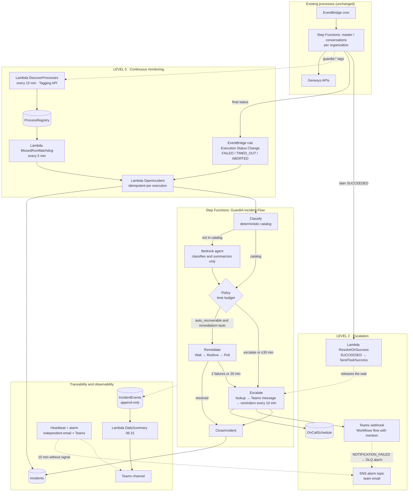
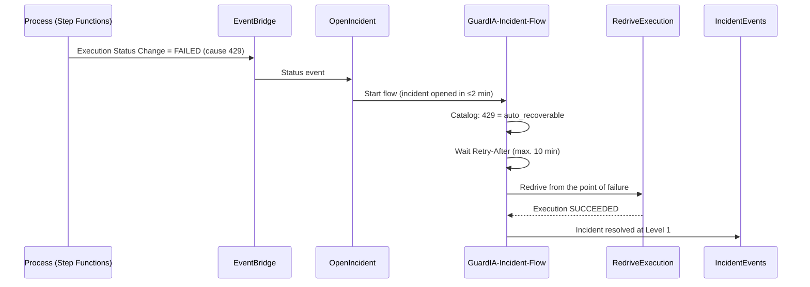
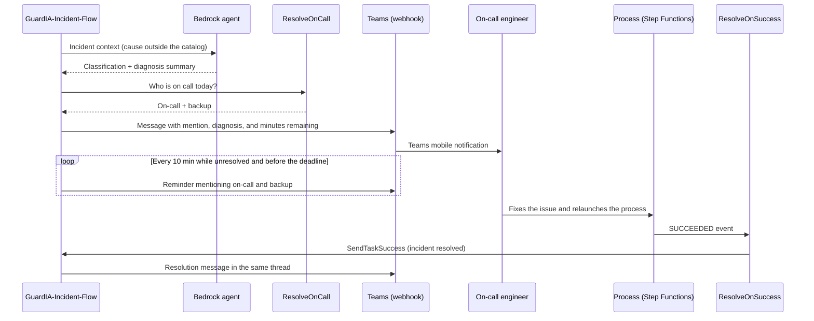

# Design Document — GuardIA

## 1. Overview

GuardIA monitors the Genesys extraction processes without modifying them. It listens to the final status of each execution (Level 0), recovers known failures with redrive (Level 1), and escalates in Microsoft Teams, with a mention of the on-call engineer and a complete diagnosis, when human judgment is needed (Level 2). It covers requirements 1 to 13 of `requirements.md`.

**Core design principle: the AI agent recommends, a deterministic policy decides.** The Amazon Bedrock agent only classifies and writes the diagnosis for errors that are not in the catalog. What action is executed, how many times, and within what time limits is decided by Step Functions, applying fixed rules. This way, a model error never turns into an action on the infrastructure.

**Stack:** Python 3.12 on AWS Lambda, AWS CDK in Python as infrastructure as code, and managed AWS services in the same region as the existing processes.

## 2. Architecture



### Sequence: 429 failure recovered at Level 1



### Sequence: unknown error escalated to Teams



## 3. Components and Interfaces

| Component | Responsibility | Input → Output | Req. |
|---|---|---|---|
| `DiscoverProcesses` (Lambda) | Lists resources with `guardia:monitor=true`, validates the other 3 tags, reads the schedules that launch each process (EventBridge rules that target it and EventBridge Scheduler schedules), computes the median duration, and updates `ProcessRegistry`; removes rows of processes no longer tagged | 15-minute schedule → registry rows and warnings | 1, 3 |
| `OpenIncident` (Lambda) | Creates the incident idempotently (conditional write by execution ARN), enriches it with `DescribeExecution`, and starts the flow. Invoked by two EventBridge rules whose patterns are defined once in `guardia_common/incidents.py` (`STATUS_CHANGE_PATTERN`: `aws.states` status change with `FAILED`/`TIMED_OUT`/`ABORTED`; `WATCHDOG_PATTERN`: `source = guardia.watchdog`) | Status event or `MissedRunWatchdog` event → incident + start of `GuardIA-Incident-Flow` | 2 |
| `MissedRunWatchdog` (Lambda) | Computes expected executions from the registry schedules; detects `MISSED_RUN` and `STUCK_RUN` and publishes each new detection to EventBridge (`source = guardia.watchdog`), which delivers it to `OpenIncident` | 5-minute schedule → detection events | 3 |
| `ClassifyIncident` (Lambda) | Applies the catalog by (process type, cause) | Incident → `auto_recoverable`, `requires_escalation`, or `unknown` | 4 |
| `InvokeAgent` (Lambda, `AgentPort`) | Investigates causes outside the catalog with read-only tools and writes the diagnosis of every escalation; Azure OpenAI or Bedrock; no actions on the infrastructure (D24) | Incident → `AgentDecision` (validated tool call) | 4, 12 |
| `RemediationPolicy` (library) | Pure function: given the incident, attempts, elapsed time, and remaining time, returns `REMEDIATE`, `REMEDIATE_AND_ESCALATE`, or `ESCALATE` | Incident state → decision | 5, 6 |
| `RedriveOrRestart` (Lambda) | Redrive if the execution is Standard; otherwise a new execution with the original input | Execution ARN → ARN of the new execution | 5, 12 |
| `PollExecution` (Lambda) | Queries the status of the recovered execution | ARN → status | 5 |
| `ResolveOnCall` (Lambda) | Reads `OnCallSchedule` by date (Colombia time) | Date → on-call and backup (with their Teams identifier) | 7 |
| `SendEscalation` (Lambda) | Posts an adaptive card with mentions to Teams through the webhook; retries 3 times and, if it keeps failing, records `NOTIFICATION_FAILED` and raises (D21) | Incident, recipients, and diagnosis → message identifier | 7 |
| `SendReminder` (Lambda) | Posts the reminder mentioning on-call and backup, or the resolution message, in the incident thread | Incident and message type → post | 8 |
| `ResolveOnSuccess` (Lambda) | Triggered by `SUCCEEDED` events of monitored processes; if there is an escalated incident for the same process and organization, calls `SendTaskSuccess` with the stored token. After the deadline, the flow keeps waiting for this signal for up to 6 hours, without reminders, to record the resolution | Status event → `RESOLVED` incident | 8 |
| `GroupIncidents` (Lambda) | Groups 3 or more incidents with the same cause within 5 minutes | Incident → individual or grouped notification | 9 |
| `DailySummary` (Lambda) | Queries `IncidentEvents`, aggregates, and posts to Teams | 06:15 schedule → summary | 11 |
| `Heartbeat` and alarm | Emits a metric every minute; if it is missing for 10 minutes, a CloudWatch alarm publishes to SNS, which sends an email to the team list and triggers a Lambda that posts to Teams | Metric → email and Teams message | 13 |

### Incident event contract

```json
{
  "incident_id": "uuid",
  "execution_arn": "arn:aws:states:...:execution:...",
  "organization": "string",
  "process_type": "master | conversations",
  "kind": "FAILED | TIMED_OUT | ABORTED | MISSED_RUN | STUCK_RUN",
  "error": "string",
  "cause": "string",
  "deadline_iso": "2026-10-14T06:00:00-05:00",
  "remediation": "auto | escalate-only"
}
```

### Agent output contract (anything that does not comply is rejected)

```json
{
  "classification": "auto_recoverable | requires_escalation",
  "recommended_action": "redrive | wait_and_redrive | escalate",
  "wait_seconds": 0,
  "diagnosis_summary": "max. 400 characters",
  "confidence": 0.0
}
```

## 4. Data Models

**`ProcessRegistry`** — PK `resource_arn`

| Field | Type | Rule |
|---|---|---|
| `process_type` | String | `master` or `conversations` |
| `organization` | String | Required |
| `remediation` | String | `auto` or `escalate-only` (any other value is treated as `escalate-only`) |
| `schedules` | List | Triggers read by `DiscoverProcesses`: `expression` (`cron(...)` or `rate(...)`), `timezone` (`UTC` for EventBridge rules, the schedule's zone for Scheduler), `source` (`events-rule` or `scheduler`), `name`. Only enabled triggers |
| `timezone` | String | Business time zone for the SLA deadline; default from SSM. Set by an operator, kept by discovery |
| `deadline_local` | String | Default `06:00`. Set by an operator, kept by discovery |
| `median_duration_s` | Number | Median of the last 14 `SUCCEEDED` executions; absent with fewer than 5 |
| `duration_samples` | Number | Executions used for the median |
| `first_seen_iso`, `last_seen_iso` | String | First and last discovery. Scheduled runs before `first_seen_iso` are not reported as missed |

**`Incidents`** — PK `incident_id`, unique index on `execution_arn`

| Field | Type | Rule |
|---|---|---|
| `status` | String | `OPEN → REMEDIATING → ESCALATED → RESOLVED`; alert state: `SLA_BREACHED` (if it is resolved later, `resolved_at` is filled in without changing the status) |
| `classification`, `level` | String, Number | `level` is 1 or 2 |
| `attempts` | Number | From 0 to 2 |
| `opened_at`, `resolved_at` | ISO string | Timestamps |
| `resolved_by` | String | `guardia` (Level 1) or `later_execution` (relaunch by a person) |
| `task_token` | String | Step Functions token that `ResolveOnSuccess` uses to close the incident; encrypted |
| `teams_thread_id` | String | Thread of the original message, for reminders and resolution |

**`IncidentEvents`** — PK `incident_id`, SK `timestamp#seq`. It is append-only: the IAM policy grants only `PutItem` with a not-exists condition. It has a 13-month TTL and point-in-time recovery.

**`ErrorCatalog`** — PK `process_type`, SK `error_pattern`

| Field | Type | Rule |
|---|---|---|
| `classification` | String | `auto_recoverable` or `requires_escalation` |
| `action` | String | `wait_and_redrive`, `redrive`, or `escalate` |
| `max_wait_s` | Number | 600 for 429 |

Initial content: 429 → `wait_and_redrive`; 403 → `escalate`; 404 with a failed execution → `escalate`; `TIMED_OUT` → `redrive`.

**`OnCallSchedule`** — PK `week_start` (Monday), with `primary` and `backup`. Each has `display_name`, `email`, and a Teams user identifier (`teams_user_id`), which is used for the mention.

**Secrets (Secrets Manager, encrypted with KMS):** webhook address of the alerts channel and webhook address of the summary channel.

## 5. Error Handling

| Scenario | System response |
|---|---|
| The agent does not respond in 30 s, returns invalid JSON, or returns a disallowed action | The incident is classified as `requires_escalation` and the event is recorded (4.6) |
| The Teams webhook returns an error | 3 retries with backoff, then `NOTIFICATION_FAILED`, the Lambda raises, and the DLQ alarm emails the team through SNS (7.3, D21) |
| No on-call engineer for the date | The backup is notified and the warning is recorded (7.4) |
| Redrive rejected because the execution is not eligible | A new execution with the original input is launched (5.1) |
| Duplicate status event or event delivered twice | The conditional write by `execution_arn` prevents duplicates (2.4) |
| A GuardIA Lambda fails | Retries with exponential backoff, SQS DLQ, and CloudWatch alarm |
| The whole GuardIA flow fails | The heartbeat alarm sends an email to the team list through an independent path and posts to Teams (13.2) |
| Escalated incident left unresolved | Reminder every 10 min mentioning on-call and backup; at the deadline it is marked `SLA_BREACHED` and the alert is posted (6.2, 8.1, 8.2, 8.4) |
| A `SUCCEEDED` event arrives for a process with no open incident | `ResolveOnSuccess` ignores it (2.2) |
| Posting the morning summary to Teams fails | 3 retries, then the failure is recorded and the alarm fires (11.4) |

## 6. Testing Strategy

- **Unit (pytest, moto):** `RemediationPolicy` with a case table (attempts, elapsed time, remaining time, remediation type); catalog and validation of the agent output schema; computation of expected executions with cron and time zone; idempotency of `OpenIncident`; incident grouping.
- **Agent:** fixtures of real and adversarial errors (ambiguous causes, text that tries to force an action). Criterion: the output always meets the contract or the flow escalates.
- **Integration (test account):** tagged synthetic state machines that fail with 429, 403, and timeout. Scenarios: 429 → redrive → resolved; 403 → Teams message → reminders → successful relaunch → `RESOLVED`; unresolved until the deadline → `SLA_BREACHED`; webhook down → `NOTIFICATION_FAILED` and alarm; stuck run → direct escalation; 30 minutes or less remaining → parallel escalation.
- **Security:** IAM policy tests that verify redrive is impossible on resources without `guardia:remediation=auto` and that `IncidentEvents` does not allow updates or deletes.
- **Quality criterion:** every acceptance criterion in `requirements.md` has at least one test that references it.

## 7. Design Decisions

| # | Decision | Alternatives considered | Rationale |
|---|---|---|---|
| D1 | Detection through Step Functions status events plus a watchdog every 5 minutes | Periodic polling only; CloudWatch alarms on logs | Events give detection in seconds with no polling cost; the watchdog covers what generates no event (executions that do not start or do not finish) |
| D2 | GuardIA defines 4 tags of its own with the `guardia:` prefix (`monitor`, `process-type`, `organization`, `remediation`) | Depending on each team's existing tags | An explicit, validatable contract of its own. Existing tags are left untouched, and `remediation` forces the owner to opt in to automatic remediation |
| D3 | The agent recommends and a deterministic policy decides | Letting the agent execute actions through action groups | Bounds the risk: the model cannot change the infrastructure or exceed the attempt and time limits |
| D4 | Amazon Nova Pro model in Bedrock, configurable | Models from other providers in Bedrock | Native AWS service, in the team's region and with no additional providers. The task is narrow (classify and summarize) |
| D5 | Escalation through Microsoft Teams with a Workflows (Power Automate) flow that receives a webhook and posts an adaptive card with mentions | WhatsApp with AWS End User Messaging Social; Microsoft Graph to call through Teams | Teams is already the team's tool and the webhook requires no Graph permissions, administrator consent, Meta account, or approved templates. The mention triggers the on-call engineer's mobile notification |
| D6 | *(Superseded by D21)* Email with Amazon SES as a backup when the webhook fails | SMS or WhatsApp as a second channel | Avoids contracting numbers and additional registrations; email reaches the same group of people through a path independent of Teams |
| D7 | No delivery or read confirmation: reminders every 10 minutes until resolved | Confirming by reply or with buttons | Teams does not expose delivery or read status through a webhook. Reminders mentioning on-call and backup cover the same risk with fewer parts |
| D8 | Budget: detection ≤ 2 min, remediation ≤ 20 min, 2 attempts, maximum wait of 10 min, reminders every 10 min, parallel escalation with 30 min or less | Fixed thresholds independent of the SLA | They come from the real margin of about 60 minutes between 4:00 a.m. and 6:00 a.m., and leave at least 25 minutes for a person to resolve |
| D9 | Redrive for Standard executions and a new execution with the original input for the rest | Always restarting from scratch | Redrive resumes from the point of failure and avoids reprocessing the master tables that already finished |
| D10 | Morning summary in a Teams channel (its own webhook), with email as backup | Email only | The summary is read during working hours, where Teams is the natural channel |
| D11 | Python 3.12 and AWS CDK in Python | Several languages or manual console | A single language for logic and infrastructure, and repeatable deployments |
| D12 | Automatic incident closure when a later execution of the same process and organization ends in `SUCCEEDED` | Having the on-call engineer close the incident by hand | Without a reply channel, the most reliable signal that the problem is resolved is the process itself. The closure is recorded with its evidence |
| D13 | No phone call, WhatsApp, or SMS in this version | Integration with Graph or with Genesys telephony | Higher cost, permissions, and complexity; Teams with mentions and reminders covers the case. Other channels can be added later |
| D14 | The schedule of each process is read from the EventBridge rule or Scheduler schedule that launches it, not from a tag | A fifth tag `guardia:schedule` | The tag can drift from the real trigger; onboarding stays at 4 tags. Rules are evaluated in UTC, Scheduler in its own zone, so each schedule keeps its zone separately from the SLA zone |
| D15 | Watchdog rules: a run that starts after the 10-minute tolerance does not cover its scheduled time (`MISSED_RUN`, closed later by the success); without history (fewer than 5 runs) the maximum duration is 50% of the period that contains the start; `rate()` schedules have no fixed times, so they are only checked for `STUCK_RUN`; the watchdog checks the last 60 minutes so a skipped cycle loses nothing, and does not publish detections whose incident already exists | Counting a late start as on time | Follows requirement 3.1 literally; the thresholds are SSM parameters |
| D16 | *(Refined by D24: the agent is part of the first version.)* The agent sits behind an `AgentPort` interface that returns the validated `AgentDecision`; adapters for Bedrock and for a model hosted in Azure. The first version has no agent: errors outside the catalog are escalated to a person with the deterministic root cause | Coupling the flow to Bedrock | Bedrock access is not available yet; the policy decides either way, so the provider can change without touching the flow. An Azure adapter needs approval for the redacted cause to leave AWS, internet egress, and a key in Secrets Manager |
| D17 | One set of GuardIA stacks for every environment, selected with a CDK context `env=dev|prod` (name prefixes, SSM thresholds, secret names). The test account also gets `GuardIA-Sim`, which refuses to deploy with `env=prod` | A separate code path or flags inside handlers for testing | What is tested is exactly what goes to production; test-only behavior (scenarios, Teams outage) lives in the simulator, not in GuardIA |
| D18 | `GuardIA-Sim` rebuilds the extraction state machines from the sanitized execution histories: same state names, flow, Map, choices, and SNS notification, with stand-in Lambdas that succeed or fail as a scenario table says (including a real `Runtime.OutOfMemory`). Step Functions retries, Map concurrency, and timeouts are assumptions | Requesting the real definitions from the owners | The test account cannot reach production data or definitions; the histories give everything GuardIA observes, and the real redrive works against real executions |
| D19 | The on-call engineer is configured with environment variables on `ResolveOnCall` (`GUARDIA_ONCALL_EMAIL`, optional `GUARDIA_ONCALL_NAME` and `GUARDIA_ONCALL_BACKUP_EMAIL`), set at deploy time and never committed. The email is the Teams mention id (UPN). When the variables are not set, `OnCallSchedule` is used. `cdk synth` fails if the email is missing | A weekly `OnCallSchedule` row loaded by script | The on-call person changes every 15 days and there is no rotation calendar yet; a deploy is a recorded change and takes under a minute. Requirement 7.1 is met as a one-person calendar with manual rotation |
| D20 | A single Teams channel for alerts and the morning summary in the first deployment: both webhook secrets hold the same address | Two channels from the start (D10) | Fewer things to set up for the tests; splitting later only changes a secret value |
| D21 | Teams is the only notification channel (replaces D6): when the webhook fails 3 times the incident records `NOTIFICATION_FAILED`, the Lambda raises, and the DLQ alarm emails the team through an SNS subscription. The heartbeat alarm uses the same SNS email path. No SES | Email with SES as a backup (D6) | Team decision of 2026-11-24 to keep the initial scope; one channel less to configure and verify (SES sandbox, sender reputation). Requirements 7.3 and 11.4 were adjusted |
| D22 | `STUCK_RUN` is always `requires_escalation`, like `MISSED_RUN` (4.4) | Classifying it with the catalog | Cancelling or relaunching an execution that is still running is not safe without the owner |
| D23 | Deployable stacks: `GuardIA-Data` → `GuardIA-Flow` (state machine, policy, remediation, escalation, `ResolveOnSuccess`) → `GuardIA-Detection` (discovery, watchdog, `OpenIncident` and its rules) → `GuardIA-Observability`. Lambdas share one arm64 layer (`pydantic`, `croniter`, `guardia_common`) built with Docker bundling. Webhook secrets are created empty and filled by hand | A separate escalation stack; one bundle per Lambda | Avoids circular references between stacks; one layer keeps every function small and identical in dependencies |
| D24 | The agent is agentic but advisory, as in the original architecture ("the AI agent recommends, a deterministic policy decides"). `InvokeAgent` runs a provider-independent tool-use loop (`AgentPort`) with read-only tools resolved from the incident (failure details, execution path, recent runs, catalog, similar incidents); the model never chooses ARNs or tables, sees only redacted and truncated data, and never step inputs or outputs. The final answer is a `submit_decision` tool call validated as `AgentDecision`; invalid output, more than 30 s, a disallowed action, or low confidence escalates (4.6). It runs in `classify` mode for `unknown` incidents (its suggestion then goes through every other `RemediationPolicy` rule) and in `diagnose` mode to write the Spanish summary of every escalation. Providers: Azure OpenAI (GPT-4.1 mini) in the test account, with endpoint and key in Secrets Manager; Amazon Bedrock (Converse API) in the workshop account, with `bedrock:InvokeModel` on one model ARN | An agent that executes actions; a single-shot classifier without tools | Keeps requirement 12.2 and every policy guardrail (tag, attempts, window, wait, observe-only) while making the diagnosis an investigation instead of a template; the same loop serves both providers, so the workshop on Bedrock and the tests on Azure exercise identical logic |
| D25 | Escalation is its own state machine, `GuardIA-Escalation-Flow`, built from `flow_escalation.build_escalation`. GuardIA-Incident-Flow runs it with `startExecution.sync` wherever it must escalate (policy ESCALATE, recovery rejected, and inside the `REMEDIATE_AND_ESCALATE` Parallel), named after the `incident_id` so an incident is escalated at most once (`ExecutionAlreadyExists` is caught). Its input is `{incident_id, classification, policy}`. Inside the Parallel, a failed escalation is caught so it does not cancel the recovery; its own failure raises the alarm | Building the escalation chain several times inside one state machine | Step Functions states cannot be shared between a Parallel branch and the rest of the graph; one escalation definition keeps T5 independent of where it is called from |
| D26 | A 429 whose cause does not state `Retry-After` waits 60 s before the redrive; the catalog's `max_wait_s` (600) is the cap, not the default | Waiting the full 600 s | The cap would spend 10 of the remediation window's 20 minutes for nothing; 60 s matches the usual rate-limit window of the Genesys APIs, and a stated value is always honored up to 600 s |

## 8. Security

- IAM roles follow least privilege, with one policy per Lambda. `RedriveOrRestart` can only run `states:RedriveExecution` and `states:StartExecution` on resources tagged `guardia:remediation=auto`, using a condition on the resource tag. Step Functions evaluates `aws:ResourceTag` on executions with the tags of their state machine, so the same condition covers `RedriveExecution` (checked in the AWS Service Authorization Reference, 2026-11-24).
- The Bedrock agent has no tools or permissions on the infrastructure.
- The Teams webhook addresses are secrets: they live in Secrets Manager, encrypted with KMS, and are never written to logs. The Workflows flow that receives the webhook can only post to the defined channel.
- The incident record does not allow updates or deletes.
