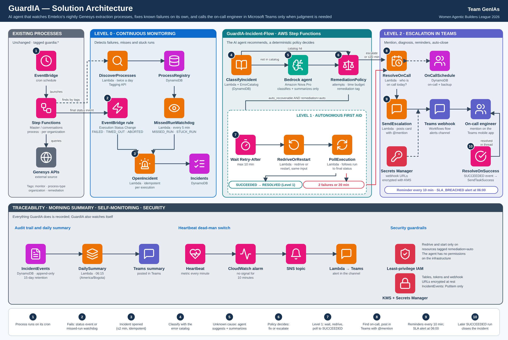

# GuardIA

AI agent that monitors Emtelco's Genesys data-extraction processes on AWS, fixes the failures it already knows how to fix, and escalates to the on-call engineer in Microsoft Teams only when human judgment is required.



## The problem

The master and conversations extraction processes run as AWS Step Functions, once per organization, and their data must be ready before **06:00 (Colombia time)**. A failure at 04:00 leaves about 60 minutes to react, and today that depends on one engineer checking by hand during the early hours.

## How GuardIA works

| Level | What it does |
|---|---|
| **0 · Monitoring** | Discovers processes by `guardia:*` tags and detects failed, missed, and stuck executions within 2 minutes |
| **1 · First aid** | Recovers known failures (e.g. 429 rate limit) with redrive or relaunch, at most 2 attempts in 20 minutes |
| **2 · Escalation** | Mentions the on-call engineer in Teams with the diagnosis and the minutes left, and reminds every 10 minutes until a later execution succeeds |

**The AI agent recommends, a deterministic policy decides.** Amazon Bedrock only classifies and summarizes errors outside the catalog; Step Functions applies fixed rules to decide what runs.

## Onboarding a process

Add these four tags to the Step Functions state machine. No code changes are needed.

| Tag | Values |
|---|---|
| `guardia:monitor` | `true` |
| `guardia:process-type` | `master`, `conversations`, … |
| `guardia:organization` | Organization name |
| `guardia:remediation` | `auto` (idempotent, GuardIA may relaunch) or `escalate-only` |

## Repository layout

| Path | Content |
|---|---|
| `.kiro/specs/guardia/` | Requirements, design, and implementation plan (Kiro spec) |
| `.kiro/steering/` | Product, tech, and structure guidelines for Kiro |
| `docs/` | Architecture diagrams and runbooks |
| `infra/` | AWS CDK app and stacks |
| `src/` | Shared library, Lambdas, and Bedrock agent definition |
| `tests/` | Unit, infrastructure, agent, and integration tests |

See [`.kiro/steering/structure.md`](.kiro/steering/structure.md) for the full tree.

## Stack

Python 3.12 · AWS CDK · Step Functions · Lambda · EventBridge · DynamoDB · Amazon Bedrock (Nova Pro) · Secrets Manager · SES · CloudWatch

## Getting started

```bash
python -m venv .venv && source .venv/bin/activate
pip install -e ".[dev]"
pytest
cdk synth
```

## Status

- [x] Specification (requirements, design, tasks)
- [x] Solution architecture
- [ ] Implementation — see [`tasks.md`](.kiro/specs/guardia/tasks.md)
