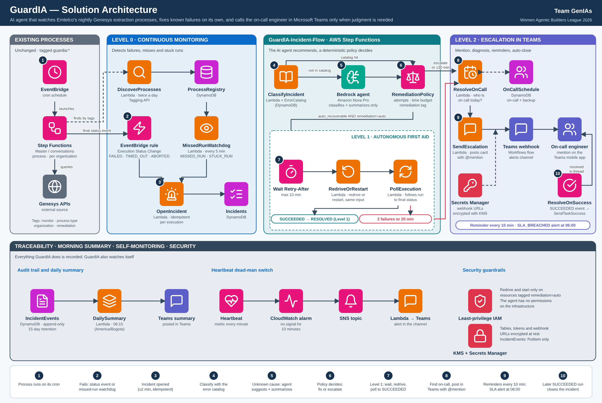

# GuardIA

AI agent that monitors Emtelco's Genesys data-extraction processes on AWS, fixes the failures it already knows how to fix, and escalates to the on-call engineer in Microsoft Teams only when human judgment is required.



## The problem

The master and conversations extraction processes run as AWS Step Functions, once per organization, and their data must be ready before **06:00 (Colombia time)**. A failure at 04:00 leaves about 60 minutes to react, and today that depends on one engineer checking by hand during the early hours.

## How GuardIA works

| Level | What it does |
|---|---|
| **0 · Monitoring** | Discovers processes by `guardia:*` tags and detects failed, missed, and stuck executions within 2 minutes |
| **1 · First aid** | Recovers known failures (e.g. 429 rate limit) with redrive or relaunch, at most 2 attempts in 20 minutes |
| **2 · Escalation** | Mentions the on-call engineer in Teams with the diagnosis and the minutes left, and reminds every 10 minutes until a later execution succeeds |

**The AI agent recommends, a deterministic policy decides.** Amazon Bedrock only classifies and summarizes errors outside the catalog; Step Functions applies fixed rules to decide what runs.

## Onboarding a process

Add these four tags to the Step Functions state machine. No code changes are needed.

| Tag | Values |
|---|---|
| `guardia:monitor` | `true` |
| `guardia:process-type` | `master`, `conversations`, … |
| `guardia:organization` | Organization name |
| `guardia:remediation` | `auto` (idempotent, GuardIA may relaunch) or `escalate-only` |

## Repository layout

| Path | Content |
|---|---|
| `.kiro/specs/guardia/` | Requirements, design, and implementation plan (Kiro spec) |
| `.kiro/steering/` | Product, tech, and structure guidelines for Kiro |
| `docs/` | Architecture diagrams and runbooks |
| `infra/` | AWS CDK app and stacks |
| `src/` | Shared library, Lambdas, and Bedrock agent definition |
| `tests/` | Unit, infrastructure, agent, and integration tests |

See [`.kiro/steering/structure.md`](.kiro/steering/structure.md) for the full tree.

## Stack

Python 3.12 · AWS CDK · Step Functions · Lambda · EventBridge · DynamoDB · Amazon Bedrock (Nova Pro) · Secrets Manager · CloudWatch

## Getting started

```bash
python -m venv ~/.venvs/guardia && source ~/.venvs/guardia/bin/activate
pip install -e ".[dev]"
pytest
npx aws-cdk@2 synth        # or `cdk synth` if the CDK CLI is installed globally
```

### Deploy to an AWS account

The environment is required: `-c env=dev` (test account, with the simulator and
shorter reminders), `-c env=workshop` (the workshop account, see below), or
`-c env=prod` (observe-only at first). See
[`infra/config.py`](infra/config.py) and
[the deployment plan](docs/analisis/plan-despliegue-entorno-pruebas.md).

```bash
cp .env.example .env        # fill in the on-call engineer; .env is gitignored
set -a; source .env; set +a
npx aws-cdk@2 deploy -c env=dev --profile analytics --all   # Data → Flow → Detection
```

Load the error catalog after the first deploy (and whenever `data/error_catalog.json` changes):

```bash
TABLE=$(aws cloudformation describe-stacks --profile analytics --stack-name GuardIA-Data \
  --query "Stacks[0].Outputs[?OutputKey=='ErrorCatalogTableName'].OutputValue" --output text)
AWS_PROFILE=analytics python scripts/load_error_catalog.py --table "$TABLE"
```

The Lambda layer is built with the local pip for Lambda arm64 (Docker is the
fallback). If pip points to an index that needs a login, set
`PIP_INDEX_URL=https://pypi.org/simple` for the command.

After the first deploy of `GuardIA-Data`, put the Teams webhook address into
both secrets once, without echoing it (`read -rs` keeps it out of the shell
history):

```bash
read -rs TEAMS_URL
for s in guardia/teams-alerts-webhook guardia/teams-summary-webhook; do
  aws secretsmanager put-secret-value --profile analytics --secret-id "$s" --secret-string "$TEAMS_URL"
done
```

### Simulator (test account only)

`GuardIA-Sim` deploys the three Genesys orchestrators rebuilt from the sanitized
histories (same names, tags, and crons) plus `SIMNOAUTO` (`escalate-only`).
GuardIA discovers and handles them like real processes; `scripts/sim.py` makes
them fail on demand:

```bash
export AWS_PROFILE=analytics AWS_DEFAULT_REGION=us-east-1
python scripts/sim.py status
python scripts/sim.py fail EMTSAS http500 --times 1 && python scripts/sim.py run EMTSAS
python scripts/sim.py fail EMT12 oom                   # real OutOfMemory, then States.Runtime
python scripts/sim.py fail EMT12 stuck --wait-minutes 40
python scripts/sim.py fail EMT22 unknown               # outside the ErrorCatalog
python scripts/sim.py missed EMT22 --minutes 70        # before the cron; do not `run` that org
python scripts/sim.py deadline EMT12 --in 40           # short deadline for SLA scenarios
python scripts/sim.py teams-down --minutes 15
python scripts/sim.py clear
```

After changing `infra/sim/definition.py`, regenerate and check the definitions
with `python scripts/build_sim_definitions.py` (`--check` in CI).

On WSL with the repository on a Windows drive (`/mnt/c`, `/mnt/d`), keep the
virtual environment on the Linux file system as above: a `.venv` inside the
repository makes the test suite about 40 times slower.

### AI agent (T8)

The agent investigates an incident with read-only tools and **recommends**; the policy
decides (D28 to D31). It runs in two places: an `unknown` error (not in the catalog) goes
through it before `RemediationPolicy`, and every escalation gets its diagnosis in the first
message. If it fails, the incident is escalated as before.

Test account (`dev`, Azure OpenAI). Fill the four `AZURE_*`/`OPENAI_*` variables of `.env`
(never commit it), deploy, and load them into the secret once:

```bash
set -a; source .env; set +a
AWS_PROFILE=analytics python scripts/load_agent_secret.py --dry-run   # checks, prints no value
AWS_PROFILE=analytics python scripts/load_agent_secret.py
```

Try it: `python scripts/sim.py fail EMT22 unknown` and read the `AGENT_DECIDED` event of the
incident, or invoke `InvokeAgent` with `{"incident_id": "...", "mode": "diagnose"}`. A wrong key
must end in `AGENT_FAILED` with `provider_error` and an escalation without diagnosis.

### Workshop account (Bedrock)

1. `npx aws-cdk@2 bootstrap aws://<account>/<region> --profile <profile>` (once per account).
2. In the Bedrock console, enable access to the model of `infra/config.py` (`workshop`:
   `amazon.nova-pro-v1:0`) and confirm it supports tool use in the Converse API. Another model is
   one line in `config.py`; for a cross-region profile use its id (for example `us.amazon...`).
3. Set the on-call person in `.env` (`GUARDIA_ONCALL_EMAIL`), and create the Teams channel and
   webhook of that account (or reuse one) and put it in the two webhook secrets as above.
4. `npx aws-cdk@2 deploy -c env=workshop --profile <profile> --all`, then load the error catalog.
5. There is no key to load: the Lambda's role may invoke only that model. To see the failure
   path, remove `bedrock:InvokeModel` from the role for a minute and open an `unknown` incident.

Local demo of `OpenIncident` and `ClassifyIncident` (in memory with moto, no AWS account needed):

```bash
python scripts/demo_open_and_classify.py
```

Local demo of all of Level 0 plus classification (`DiscoverProcesses`, `MissedRunWatchdog`, `OpenIncident`, `ClassifyIncident`): a whole night (23:00 to 06:00 Bogota) on a virtual clock. The real executions are replayed every hour, along with the two real failures, a redelivered event, and missed, delayed, and stuck runs:

```bash
python scripts/demo_discovery_and_watchdog.py
```

## Status

- [x] Specification (requirements, design, tasks)
- [x] Solution architecture
- [ ] Implementation — see [`tasks.md`](.kiro/specs/guardia/tasks.md)
